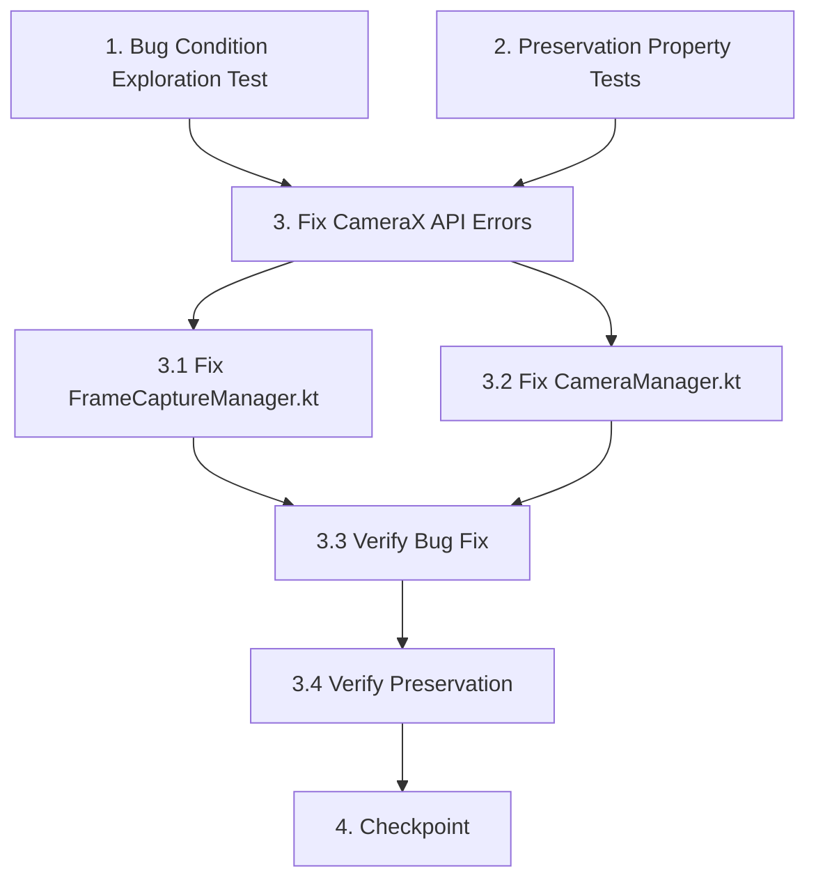

# Implementation Plan

## Overview

This task list implements the bugfix for CameraX API compilation errors using the exploratory bugfix workflow. The approach follows three phases: (1) explore the bug by running CI build on unfixed code to capture exact compilation errors, (2) document preservation requirements by reviewing existing behavior patterns, and (3) implement the four API reference corrections and verify both fix and preservation.

## Task Dependency Graph



```json
{
  "waves": [
    {
      "name": "Wave 1: Exploration",
      "tasks": ["1", "2"]
    },
    {
      "name": "Wave 2: Implementation",
      "tasks": ["3.1", "3.2"]
    },
    {
      "name": "Wave 3: Verification",
      "tasks": ["3.3", "3.4"]
    },
    {
      "name": "Wave 4: Checkpoint",
      "tasks": ["4"]
    }
  ]
}
```

## Tasks

- [x] 1. Write bug condition exploration test
  - **Property 1: Bug Condition** - Correct API References Compile Successfully
  - **CRITICAL**: This test MUST FAIL on unfixed code - failure confirms the bug exists
  - **DO NOT attempt to fix the test or the code when it fails**
  - **NOTE**: This test encodes the expected behavior - it will validate the fix when it passes after implementation
  - **GOAL**: Surface counterexamples that demonstrate the bug exists
  - **Approach**: Run CI build on unfixed code and capture exact compilation errors
  - Trigger GitHub Actions workflow on current (unfixed) branch
  - Examine CI logs from `:app:compileDebugKotlin` step
  - Capture and document the four specific unresolved reference errors:
    - "Unresolved reference 'ImageCaptureException'" at FrameCaptureManager.kt line 32
    - "Unresolved reference 'message'" at FrameCaptureManager.kt line 34 (if present)
    - "Unresolved reference 'minZoom'" at CameraManager.kt line 250
    - "Unresolved reference 'maxZoom'" at CameraManager.kt line 251
  - **EXPECTED OUTCOME**: Build FAILS with compilation errors (this is correct - it proves the bug exists)
  - Document counterexamples found to understand root cause
  - Mark task complete when CI build is run, logs are examined, and failures are documented
  - _Requirements: 2.1, 2.2, 2.3, 2.4, 2.5_

- [ ] 2. Write preservation property tests (BEFORE implementing fix)
  - **Property 2: Preservation** - Existing Camera Functionality Unchanged
  - **IMPORTANT**: Follow observation-first methodology
  - Review the UNFIXED code to understand existing behavior patterns:
    - Frame capture success handling: `onImageSaved` adds FrameData to frames list
    - Error logging: uses Android Log with tag "FrameCaptureManager"
    - Zoom clamping: constrains ratio using min/max from ZoomState
    - Null safety: handles null zoomState with fallback values
    - Camera lifecycle: bind/unbind operations use main thread
  - Document the observed behavior patterns that must be preserved
  - Identify existing integration tests that validate this behavior:
    - `CameraManagerIntegrationTest.kt` - camera binding and zoom
    - `ScannerIntegrationTest.kt` - frame capture with error handling
  - **EXPECTED OUTCOME**: Behavior patterns documented as baseline to preserve
  - Mark task complete when behavior patterns are documented and existing tests are identified
  - _Requirements: 3.1, 3.2, 3.3, 3.4, 3.5_

- [ ] 3. Fix CameraX API compilation errors

  - [~] 3.1 Fix FrameCaptureManager.kt - ImageCaptureException reference
    - Open file: `dorja/app/src/main/java/com/example/scanner/FrameCaptureManager.kt`
    - Add import at top of file: `import androidx.camera.core.ImageCaptureException`
    - Locate line 32 in `captureFrame` method's `onError` callback
    - Change `exception: ImageCapture.ImageCaptureException` to `exception: ImageCaptureException`
    - Verify line 34 (`exception.message`) resolves correctly with corrected type
    - If `exception.message` still shows unresolved, use null-safe access: `exception.message ?: "Unknown error"`
    - Save file
    - _Bug_Condition: isBugCondition(input) where input.file == "FrameCaptureManager.kt" AND input.containsReference("ImageCapture.ImageCaptureException")_
    - _Expected_Behavior: Kotlin compiler resolves ImageCaptureException as top-level class from androidx.camera.core_
    - _Preservation: Frame capture error logging continues to log errors to Android Log with tag "FrameCaptureManager"_
    - _Requirements: 2.1, 2.2, 3.1, 3.2_

  - [~] 3.2 Fix CameraManager.kt - ZoomState property access
    - Open file: `dorja/app/src/main/java/com/example/scanner/CameraManager.kt`
    - Locate line 250 in `setZoomRatio` method
    - Change `zoomState?.minZoom` to `zoomState?.minZoomRatio`
    - Locate line 251 in `setZoomRatio` method
    - Change `zoomState?.maxZoom` to `zoomState?.maxZoomRatio`
    - Verify null-safe access pattern is preserved: `zoomState?.minZoomRatio ?: 1.0f`
    - Save file
    - _Bug_Condition: isBugCondition(input) where input.file == "CameraManager.kt" AND (input.containsPropertyAccess("zoomState.minZoom") OR input.containsPropertyAccess("zoomState.maxZoom"))_
    - _Expected_Behavior: Kotlin compiler resolves minZoomRatio/maxZoomRatio as properties that call getMinZoomRatio()/getMaxZoomRatio() methods_
    - _Preservation: Zoom ratio clamping logic continues to constrain values to camera's supported range using correct API_
    - _Requirements: 2.3, 2.4, 2.5, 3.3, 3.4, 3.5_

  - [~] 3.3 Verify bug condition exploration test now passes
    - **Property 1: Expected Behavior** - Correct API References Compile Successfully
    - **IMPORTANT**: Re-run the SAME test from task 1 - do NOT write a new test
    - The test from task 1 encodes the expected behavior
    - When this test passes, it confirms the expected behavior is satisfied
    - Commit the fixes to git
    - Push to GitHub to trigger CI build
    - Monitor `:app:compileDebugKotlin` step in GitHub Actions workflow
    - **EXPECTED OUTCOME**: Build PASSES with zero unresolved reference errors
    - Verify no "Unresolved reference" errors in CI logs for FrameCaptureManager.kt or CameraManager.kt
    - Verify CI proceeds to APK assembly and release steps
    - _Requirements: Expected Behavior Properties from design (2.1, 2.2, 2.3, 2.4, 2.5)_

  - [~] 3.4 Verify preservation tests still pass
    - **Property 2: Preservation** - Existing Camera Functionality Unchanged
    - **IMPORTANT**: Re-run the SAME tests from task 2 - do NOT write new tests
    - Run existing integration tests to verify preserved behavior:
      - `CameraManagerIntegrationTest.kt` - verify camera binding and zoom functionality
      - `ScannerIntegrationTest.kt` - verify frame capture with error handling
    - Review fixed code to confirm only type/method names changed, not logic:
      - Frame capture success callback (`onImageSaved`) unchanged
      - Error logging pattern unchanged (only exception type corrected)
      - Zoom clamping logic unchanged (only property access corrected)
      - Null safety checks unchanged
      - Thread execution unchanged
    - **EXPECTED OUTCOME**: All integration tests PASS, confirming no regressions
    - Confirm all tests still pass after fix (no regressions)

- [~] 4. Checkpoint - Ensure all tests pass
  - Verify CI build completes successfully with APK generated
  - Verify all integration tests pass
  - Verify no new compilation errors introduced
  - Ask the user if questions arise


## Notes

- **No Local Gradle Builds**: Per workspace rules, do NOT run Gradle locally. All compilation verification happens through GitHub Actions CI.
- **CI Log Location**: After CI build fails/succeeds, check the Actions workflow logs or the `ci-logs` branch (`ci-errors.txt`) for detailed compilation output.
- **Exploration Test Philosophy**: Task 1 MUST fail on unfixed code - this is the correct outcome that confirms the bug exists. Do NOT attempt to fix the code when the exploration test fails.
- **Preservation Focus**: Since these are pure API corrections with no logic changes, preservation checking focuses on code review and existing integration tests rather than new test creation.
- **API Documentation References**:
  - [OnImageSavedCallback](https://developer.android.com/reference/androidx/camera/core/ImageCapture.OnImageSavedCallback) - shows `onError(ImageCaptureException)` signature
  - [ZoomState](https://developer.android.com/reference/androidx/camera/core/ZoomState) - shows `getMinZoomRatio()` and `getMaxZoomRatio()` methods
